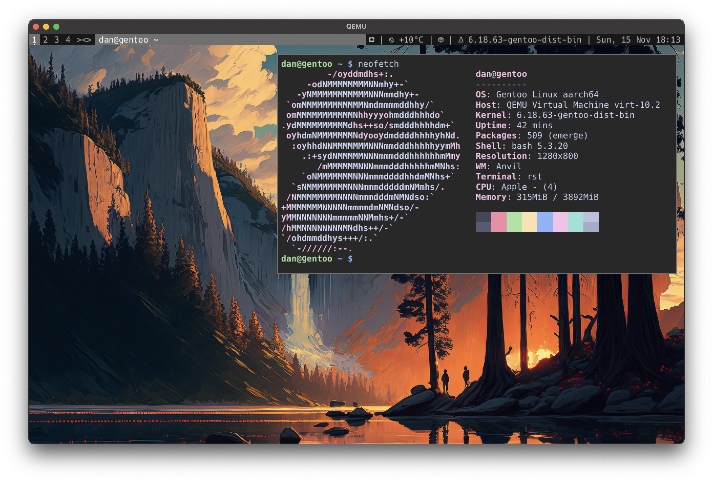
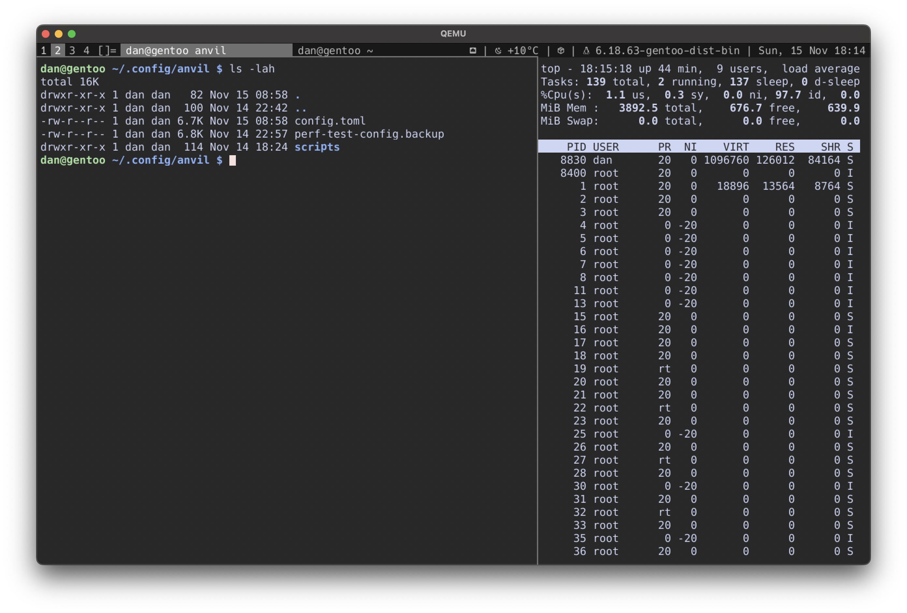

<p align="center">
  
</p>

<h1 align="center">Anvil</h1>
<p align="center"><strong>A small desktop that works your way.</strong></p>

A keyboard-driven **Wayland window manager for Linux**, written in Rust and
inspired by dwm. Tiling, floating windows, tags, an app launcher, a window overview
and a scriptable status bar come together in one compact desktop.

## Your tags, your layouts

**Independent layouts per tag work out of the box.** Keep Tag 1 floating for a
relaxed desktop, Tag 2 tiled for terminals and Tag 3 in monocle for focused work.
Switching tags brings back that tag's layout; changing one leaves the others alone.
Each monitor keeps its own tag layouts too.

**Super+Space** cycles the current tag through three modes:

- **Tiling `[]=`** — a main window beside a stack of other windows.
- **Monocle `[ ]`** — one window fills the available workspace.
- **Floating `><>`** — place and resize windows freely.



*Floating on one tag: Anvil running on Gentoo Linux in QEMU, with
[rst](https://github.com/dme86/rst), a wallpaper and custom status scripts.
Neofetch's “WM: sway” is a detection mistake caused by the wallpaper process
`swaybg`; the compositor is Anvil.*



*Tiling on another tag: terminals arranged side by side, with the same built-in
bar. The screenshots show a configured desktop; wallpapers and status scripts
are optional additions.*

Tag layouts last for the current Anvil session. If several tags are selected,
the lowest numbered selected tag determines the layout.

## More than tiling

- **Find your apps.** **Super+P** opens the app launcher. **Super+Tab** shows
  windows across tags and monitors so you can jump straight to one.
- **Make the bar yours.** Tags, window titles and your own shell scripts share
  one bar. Weather, network, battery, kernel and Gentoo-update examples are
  included. Each block updates independently, so a slow script cannot hold up
  the desktop. **Super+B** hides the bar and gives the space back to windows.
- **Use all your monitors.** Focus or move windows with directional shortcuts.
  Set resolution, scale, rotation and position per display. Disconnecting a
  monitor moves its windows onto an available output.
- **Let dialogs float.** Window rules can keep dialogs floating or send an app
  to a chosen tag and monitor. In floating mode, **Super+drag** moves windows;
  **Super+right drag** resizes them.
- **Bring your tools.** The default build supports wallpaper clients such as
  `swaybg` and external panels such as Waybar. Clipboard, primary selection,
  screen capture and session-lock protocols are supported. Older X11 apps can
  use the optional XWayland build.

## Shortcuts

| Action | Default shortcut |
| --- | --- |
| Open terminal | **Super+Enter** |
| App launcher | **Super+P** |
| Window overview | **Super+Tab** |
| Next layout on the current tag | **Super+Space** |
| Switch to tag 1–9 | **Super+1…9** |
| Send a window to a tag | **Super+Shift+1…9** |
| Focus next / previous window | **Super+J / K** |
| Shrink / grow the master area | **Super+H / L** |
| Move a window to master | **Super+Shift+Enter** |
| Focus a neighboring monitor | **Super+Arrow** |
| Move a window to a neighboring monitor | **Super+Shift+Arrow** |
| Hide / show the bar | **Super+B** |
| Close focused window | **Super+Shift+C** |
| Quit Anvil | **Super+Shift+Q** |

Four tags are configured by default; you can use up to nine. Change the modifier
and shortcuts in [config.toml](config.toml).

## Get started

Use a [prebuilt release](https://github.com/dme86/anvil/releases) for your CPU
architecture, or build on Linux with **Rust 1.87+** and the development libraries
for EGL, GBM, libinput, libseat, libudev, Wayland and xkbcommon:

```sh
git clone https://github.com/dme86/anvil.git
cd anvil
make build
sudo make install

mkdir -p ~/.config/anvil
cp -n config.toml ~/.config/anvil/config.toml
```

Install a cursor theme and a terminal separately. Anvil opens
[**rst**](https://github.com/dme86/rst) by default; put it on your `PATH` or set
`general.terminal` to your preferred terminal.

Select **Anvil** in your login manager, or run `anvil` from a free local TTY.
Your system needs working graphics/input access through logind or seatd.
For development inside an existing graphical session, use `anvil --nested`.
See [build and installation](docs/build-and-install.md) for prerequisites,
installation paths and smaller builds without the built-in UI.

## Make it yours

Settings live in **`~/.config/anvil/config.toml`**. Start with the supplied
[example](config.toml), then choose your terminal, gaps, fonts, colors, keyboard,
displays and window rules.

```toml
[general]
terminal = "rst"
# Optional: install swaybg separately and choose an existing image.
# startup = ["swaybg -i ~/Pictures/wallpaper.jpg -m fill"]

[layout]
gap = 0
outer_gap = 0

[bar]
font = "Hack Nerd Font Mono"
font_size = 16.0
# Optional: make Nerd Font icons larger without enlarging the text.
icon_size = 19.0
```

Install the **full patched Nerd Font** when using status icons; a symbol-only
font is not a substitute for a text font. Wallpaper clients and status scripts
run as separate programs; Anvil does not download or configure them for you.

The [included status scripts](scripts/bar) cover weather, network, battery,
kernel and Gentoo updates. Copy the ones you want and add `[[bar.blocks]]`
entries using the [status-bar guide](docs/async-bar-blocks.md).

```sh
anvilctl config validate
anvilctl config set layout.gap 0 --reload
anvilctl output list
anvilctl window list
```

Most appearance settings and status blocks can reload while you work. Changing
the bar's font family, keyboard layout or startup commands needs a restart.
See the [configuration guide](docs/configuration.md) for examples and details.

## Development

```sh
make check
make build
```

Anvil is under active development. Hardware compatibility depends on your GPU,
drivers and seat setup; see [hardware validation](docs/hardware-validation.md).
For implementation and performance details, see the
[idle CPU profiling guide](docs/idle-cpu-profiling.md) and
[release notes](docs/releases).

[Issues](https://github.com/dme86/anvil/issues) and contributions are welcome.
[MIT license](LICENSE).
